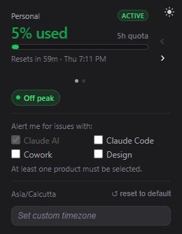
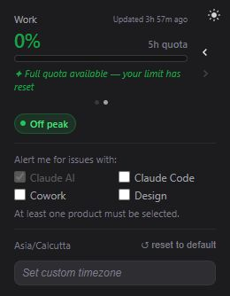

# QuotaBeacon

A compact Chrome extension for Claude quota usage, reset times, peak hours and outage status. QuotaBeacon is independent of Anthropic.

## Usage at a glance

- The toolbar circle follows the Account that most recently produced a Usage reading: green through 60%, orange above 60% through 85%, red above 85%. No reading or an expired quota is green.
- Send a message on claude.ai to capture usage. Readings update after messages; the extension does not continuously poll quota or track weekly/token totals.
- Multiple Accounts in the same Chrome profile get separate pages. Active stays first; Full accounts follow Accounts with available quota.
- Non-Active pages show “Updated … ago” beside the name after 10 minutes. Expired readings show 0% and full quota. Accounts unused for more than 48 hours are forgotten automatically.
- The status pill, PEAK/DOWN badge and hover tooltip show public peak-hours and incident information. The toolbar circle remains usage-driven.
- Choose light/dark theme, timezone and Watched products. Claude AI is selected by default.

<table>
<tr>
<td></td>
<td></td>
</tr>
</table>

Screenshots use development fixtures, not real Account readings.

## Try locally

1. Open chrome://extensions and enable Developer mode.
2. Choose **Load unpacked** and select this repository's folder, or extract the release ZIP and select its folder.
3. Pin QuotaBeacon, sign in to claude.ai and send a message yourself. Open the popup to see its first reading.
4. To add another Account, use it in the same Chrome profile and send a message. Use the popup arrows or left/right keys to compare readings.

Logging in alone does not switch Active. Usage depends on Claude returning a quota event with the completion response. QuotaBeacon covers the 5-hour quota carried by that event; it does not raise limits or provide usage history.

Capture supports both the original completion SSE and Bard's binary `ConversationService/StreamTimeline` response, including gzip-compressed quota messages. Only the five-hour window is used. A missing numeric quota field does not establish 0% usage and does not replace the Active account's reading.

## Privacy

Account names (which may be email addresses) and Usage readings stay in this extension's local Chrome storage and are not uploaded to the developer or third parties. Preferences may sync through Chrome. QuotaBeacon fetches public status information and Account labels directly from Claude; it does not save or upload prompts or replies, and has no analytics backend.

[Full disclosure and permission explanations](docs/release/privacy-disclosure.md). Reset to default forgets all Accounts and restores system timezone, Claude AI only and dark theme.

## Release status

QuotaBeacon 1.0.0 is prepared for a **new Chrome Web Store listing**. It has not been submitted by this task. The earlier Peak Hours for Claude listing is a separate extension and does not automatically migrate users or readings.

[Release checklist](docs/release/manual-qa.md) · [Design reference](design.md) · [Domain language](CONTEXT.md)

Run checks with Node's built-in test runner:

    node --test tests/*.test.js

No dependencies, build step or separate typechecking configuration are required.

## Credits

The peak-hours feature was inspired by [PeakClaude](https://github.com/pforret/PeakClaude) by [@pforret](https://github.com/pforret).
