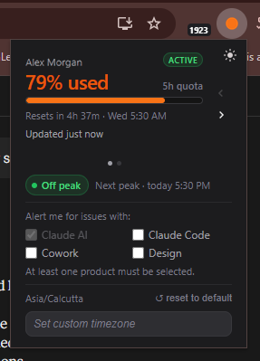
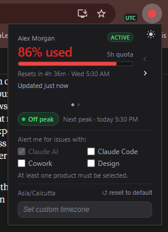
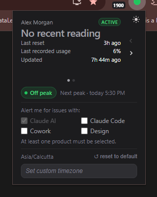
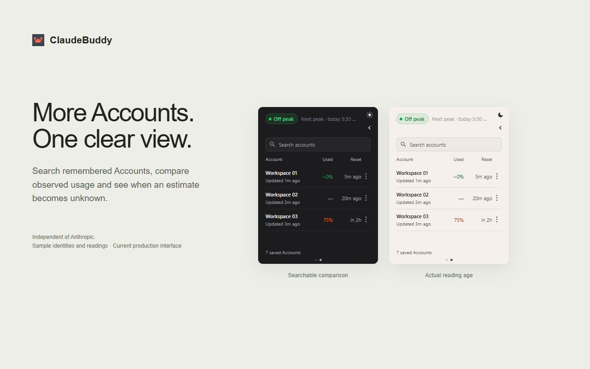

# ClaudeBuddy

Usage, peak hours & outage status for Claude. Independent of Anthropic.

[Project](https://github.com/abhikmp/claudebuddy-chrome-ext) · [Support / report an issue](https://github.com/abhikmp/claudebuddy-chrome-ext/issues) · [Legacy Peak Hours source](https://github.com/abhikmp/claudebuddy-chrome-ext/tree/legacy)

[Download the 1.0.0 candidate](https://github.com/abhikmp/claudebuddy-chrome-ext/releases/tag/claudebuddy-v1.0.0-rc.1) · [Public privacy policy](https://abhikmp.github.io/claudebuddy-chrome-ext/privacy-policy.html)

- Capture a five-hour Usage reading after sending a message on claude.ai. Readings are observations, not continuously live quota; weekly/token totals are not tracked.
- Compare one to three Accounts through detail slides. Four or more use Active detail and a searchable, internally scrolling table, within 260 × 340px.
- See actual reading age and captured reset times. After reset, table estimates last 15 minutes and detail estimates three hours, then usage is unknown. Estimates never become observations.
- Remember Accounts indefinitely. Forget another Account with confirmation and a 2.5-second Undo; a later reading can rediscover it. Reset clears Accounts and restores preferences.
- Check public incidents and the configured weekday Pacific peak window. Choose watched products, timezone and light/dark theme.

The toolbar follows Active: green through 60%, orange through 85%, then red. Missing/expired readings use green as a neutral policy, not proof of full quota. OUT takes priority over PEAK; availability badges/tooltips are independent of usage. Browsing or logging in alone never switches Active; a new reading does.

Different usage states, shown in the screenshots provided by the publisher:

| 79% used | 86% used | No recent reading |
| --- | --- | --- |
|  |  |  |
| Orange indicates 61–85% used. | Red indicates usage above 85%. | The last observation stays visible; the green icon does not confirm current usage. |

Account comparison:

The Account comparison screenshot uses current production code with disposable sample identities/readings, not live Claude evidence.

## Try locally

Requires Chrome 120+. Open chrome://extensions, enable Developer mode and load this folder, or download a ZIP from [GitHub Releases](https://github.com/abhikmp/claudebuddy-chrome-ext/releases), extract it and load its folder. Pin ClaudeBuddy, sign in to claude.ai and send a message yourself. Use another Account in the same Chrome profile and send a message to remember it.

Capture supports completion SSE and Bard StreamTimeline RPC, including gzip quota events. Claude must return a numeric five-hour quota event; missing data never implies zero. Site/plan changes can make capture unavailable. No API key is required; the extension cannot raise limits.

## Privacy and development

Account UUIDs, names (possibly emails), readings and Undo recovery are encrypted locally with AES-256-GCM; a non-extractable key is stored separately in extension IndexedDB. This is not a hardware-backed vault. Preferences may sync through Chrome. HTTPS public status and same-origin organization requests use the existing Claude session. Copied streams can transiently contain replies; conversation content is not retained/uploaded. No ads, analytics or developer backend.

[Privacy policy](docs/release/privacy-policy.md) · [data-use declarations](docs/release/privacy-disclosure.md) · [design/data flow](design.md) · [domain vocabulary](CONTEXT.md)

Run `node --test tests/*.test.js`. This plain-JavaScript project has no typechecking configuration or dependency/build installation. Run `python tools/build-release.py` to create the allowlisted ZIP, integrity record and extracted-script syntax checks in `dist/`. Icon rasterization uses Pillow via `python tools/render-icons.py`; ZIP rebuilding uses checked-in PNGs and Python's standard library. See [contributing](CONTRIBUTING.md) for the repository layout and verification workflow.

## Release candidate

Version 1.0.0 is prepared for a **new** Chrome Web Store item. [Release verification](docs/release/verification.md), [release notes](docs/release/release-notes.md), [manual checklist](docs/release/manual-qa.md), [launch checklist](docs/release/launch-checklist.md). On 28 October 2026, the publisher confirmed the latest candidate passed real capture, Account switching and toolbar checks after the security and popup repairs. Store submission and publication are tracked separately. Peak Hours for Claude is a separate legacy item; users/storage do not automatically migrate between extension IDs.

Peak hours was inspired by [PeakClaude](https://github.com/pforret/PeakClaude) by [@pforret](https://github.com/pforret). The owner reports that licensing decisions are complete; no repository-wide licence file is currently included in this checkout.

The single reported [timezone issue](docs/issues/timezone-offset.md) is deferred until after release. It is not a release blocker.
